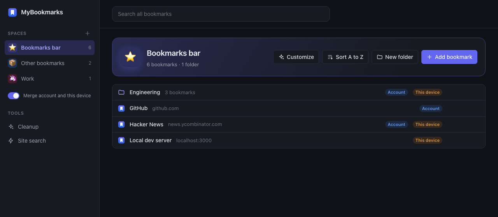
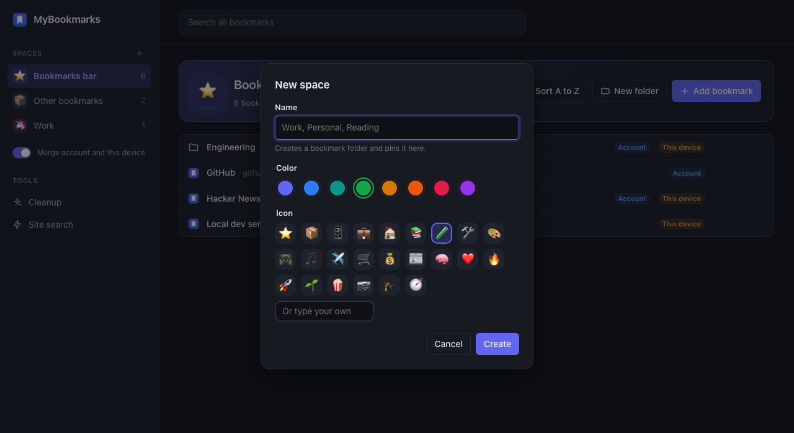
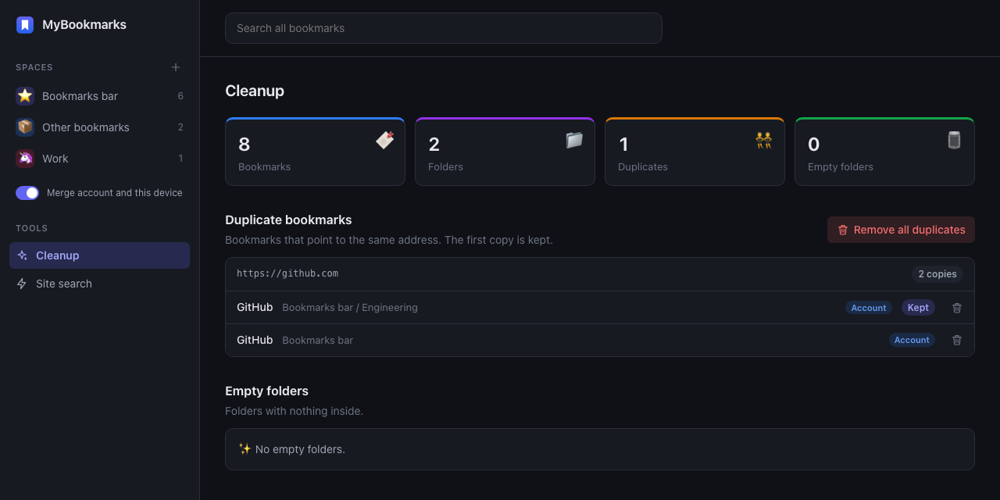

# MyBookmarks

**Your Chrome bookmarks, finally tidy.**

Spaces with color and personality, one merged view of account and device bookmarks, and a cleanup page that finds the mess for you.

---

## Why

Chrome's bookmark manager is a plain folder tree. MyBookmarks sits on top of it and adds what it lacks, without ever copying your links somewhere else.

- 🗂️ **Organize** with spaces you can color, name and give an emoji
- 🧹 **Clean up** duplicates and empty folders in a couple of clicks
- ↩️ **Stay safe** with two-click deletes and an Undo on every one

## Features

|     | Feature               | What you get                                                                                                                                                                                  |
| --- | --------------------- | --------------------------------------------------------------------------------------------------------------------------------------------------------------------------------------------- |
| ⭐  | **Spaces**            | Any folder can be pinned to the sidebar as a space. Pick a color, pick an emoji (or type your own), and the whole view takes on its tint.                                                     |
| 🔀  | **Merged view**       | Chrome keeps separate "account" and "this device" copies of Bookmarks bar and Other bookmarks. One toggle shows them as a single space, with an `Account` / `This device` label on every row. |
| 📁  | **Folders**           | Create, rename, delete, and drag to reorder. Drop on a row's edge to place above or below it, or on a folder to move inside.                                                                  |
| 📦  | **Move to…**          | Send any bookmark or folder to any other folder from a searchable list.                                                                                                                       |
| 🔤  | **Sort A to Z**       | One confirmable click, folders first. Undo puts the old order back.                                                                                                                           |
| 🔍  | **Search**            | Filters every bookmark by title and address as you type.                                                                                                                                      |
| 🧹  | **Cleanup**           | Counts your bookmarks and folders, lists duplicates and empty folders, and removes them one at a time or all at once.                                                                         |
| ↩️  | **Undo**              | Deleting takes two clicks, then a toast offers Undo. Folders come back with everything inside them.                                                                                           |
| 🔎  | **Site search guide** | Explains Chrome's built-in site search and `%s`, with a button straight to Chrome's settings.                                                                                                 |
| 🌗  | **Light, dark, slim** | Follows your system theme and reflows for narrow windows.                                                                                                                                     |

## Install

1. Open `chrome://extensions`
2. Turn on **Developer mode** (top right)
3. Click **Load unpacked** and choose this folder
4. Click the MyBookmarks icon in the toolbar

## A quick tour

| To do this                             | Do this                                                                                       |
| -------------------------------------- | --------------------------------------------------------------------------------------------- |
| Make a space                           | Click **+** next to Spaces, or open a folder and click **Make space**                         |
| Restyle or rename a space              | Open it and click **Customize**                                                               |
| Reorder                                | Drag a row onto the top or bottom edge of another row                                         |
| Move somewhere far away                | Hover a row and click the folder-arrow button                                                 |
| Delete                                 | Click the trash, then click **Confirm delete**. Changed your mind? Hit **Undo** in the toast. |
| See account and device bookmarks apart | Turn off **Merge account and this device**                                                    |

## What it stores

Your bookmarks live in Chrome and nowhere else. MyBookmarks keeps only a few settings, all on this computer:

| Stored                   | Size                      | Removed when                                  |
| ------------------------ | ------------------------- | --------------------------------------------- |
| Which folders are spaces | One id per space          | The space is removed or its folder is deleted |
| Space color and icon     | One small entry per space | Same as above                                 |
| Merge toggle             | One true/false            | Never (single value)                          |

Nothing is sent anywhere. There is no account, no server and no analytics.

## Permissions

| Permission  | Why                                        |
| ----------- | ------------------------------------------ |
| `bookmarks` | Read and edit your bookmarks               |
| `storage`   | Save the settings listed above             |
| `favicon`   | Show each site's icon next to its bookmark |

No access to the pages you visit.

## The one rule

> If Chrome already does it, MyBookmarks links to it instead of rebuilding it.

That is why there is no second list of links, no custom search shortcuts and no address-bar keyword. Chrome owns those; this extension owns the organizing.

## Develop

No build step. Edit a file, reload the extension.

| Command           | Purpose                                                                    |
| ----------------- | -------------------------------------------------------------------------- |
| `npm test`        | Run the unit tests for `src/lib`                                           |
| `npm run icons`   | Regenerate `icons/*.png`                                                   |
| `npm run package` | Zip `manifest.json`, `src` and `icons` into `../mybookmarks-<version>.zip` |

| Path                               | Role                                                                                                   |
| ---------------------------------- | ------------------------------------------------------------------------------------------------------ |
| `src/background/service-worker.js` | Opens the manager on toolbar click and clears space settings when a folder is deleted. Holds no state. |
| `src/lib`                          | Shared logic and storage access. The pure logic is unit tested.                                        |
| `src/manager`                      | The manager page: views, dialogs, toasts, drag and drop, undo.                                         |
| `test`                             | `node --test` suites with no dependencies.                                                             |
| `docs`                             | README screenshots, made with sample data. Not shipped in the package.                                 |

The version lives only in `manifest.json`. Bump it before every Web Store upload.
